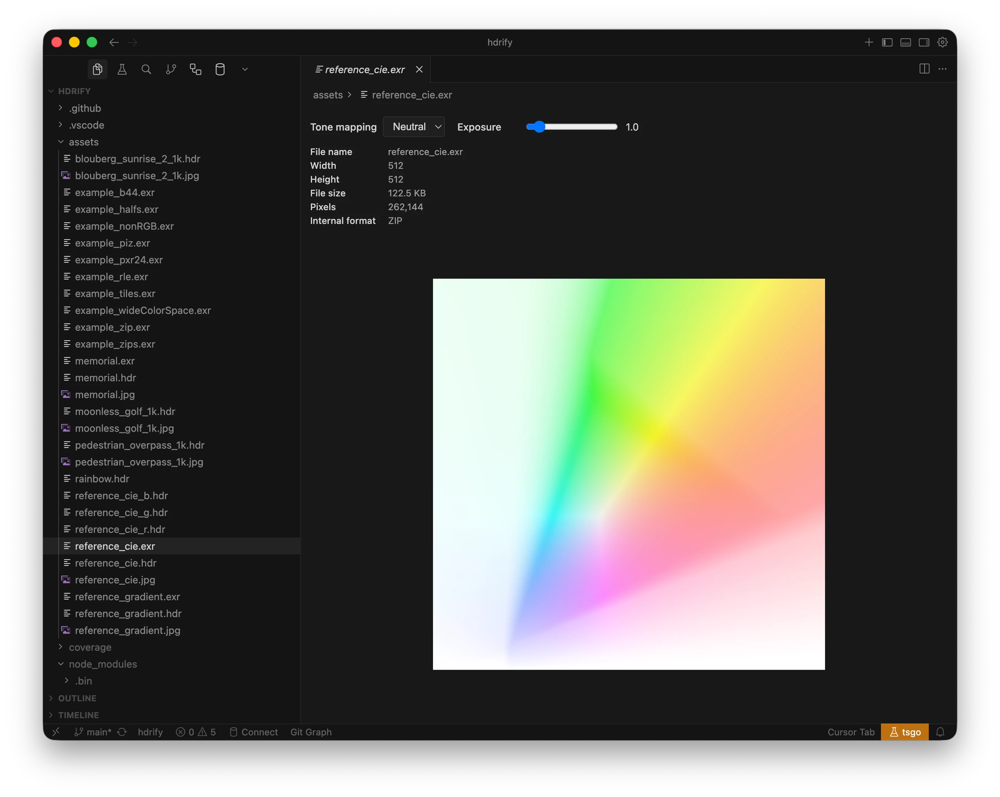

# HDR image previews in your editor

Install HDRify from the [Visual Studio Code Marketplace](https://marketplace.visualstudio.com/items?itemName=benhouston3d.hdrify-vscode-extension) or [Open VSX](https://open-vsx.org/extension/benhouston3d/hdrify-vscode-extension) for Cursor.

## HDR Image Preview

- **EXR, HDR and JPEG XL**: Click any `.exr`, `.hdr` or `.jxl` file in the Explorer to open it with the HDR Image Preview (default action). The preview shows metadata (width, height, file size, pixels, internal format), an EV exposure slider and the same tone-mapping selector as `<image-viewer>`. **None** appears and is the default only when extended FP16 WebGPU HDR output succeeds. Otherwise **None** is hidden and **Neutral** is the default. There is no Automatic option. AgX, ACES and Reinhard remain available in both modes.
- **JPEG**: For UltraHDR Jpeg files, right-click and choose **Open with HDR Image Preview**. Standard JPEGs open with the built-in viewer by default; use "Reopen Editor With → HDR Image Preview" to try opening as HDR (will show an error if not a gain-map JPEG).



JPEG XL uses the shared React `ImageViewer` loader, also used by `<image-viewer>`. Both bare codestreams and containers are supported, with lossless or lossy pixels. Animated files show their first displayed frame; the status includes bit depth, encoding, color space and frame count.

## Convert HDR Image

Right-click an EXR, HDR, JPEG XL, or UltraHDR Jpeg in the Explorer. A **Convert HDR Image** submenu appears with:

- **Convert to EXR** — Output uses PIZ compression by default (configurable).
- **Convert to HDR** — Radiance RGBE format.
- **Convert to JPEG XL** — Lossless Modular encoding with 16-bit floating-point samples by default. Set `hdrify.jxlBitDepth` to `float32` to retain decoded source precision.
- **Convert to UltraHDR Jpeg** — JPEG with gain map (Ultra HDR / JPEG-R).

**Multi-select**: Select multiple files and right-click to convert all of them in one action. A progress indicator appears when processing two or more images.

## Supported Formats

| Format        | Extension       | Preview  | Convert |
| ------------- | --------------- | -------- | ------- |
| OpenEXR       | `.exr`          | Default  | ✓       |
| JPEG XL       | `.jxl`          | Default  | ✓       |
| Radiance HDR  | `.hdr`          | Default  | ✓       |
| UltraHDR Jpeg | `.jpg`, `.jpeg` | Optional | ✓       |

## Configuration

| Setting                                  | Type    | Default | Description                                                                                             |
| ---------------------------------------- | ------- | ------- | ------------------------------------------------------------------------------------------------------- |
| `hdrify.conversionQuality`               | number  | 90      | Quality for UltraHDR JPEG output (0–100)                                                                |
| `hdrify.leaveOriginalWhenChangingFormat` | boolean | false   | When converting, leave the original file and write to a new file (same name, target extension)          |
| `hdrify.exrCompression`                  | string  | `"piz"` | Compression for EXR output: `none`, `rle`, `zips`, `zip`, `piz`, `pxr24`, `b44`, `b44a`, `dwaa`, `dwab` |

JPEG XL is available in the same **Convert HDR Image** submenu as the other outputs. All four formats work as inputs, including batch selections. Float16 output rounds to half precision before lossless encoding; float32 retains decoded source precision. Animated JXL conversion uses the first displayed frame.

Additional setting: **`hdrify.jxlBitDepth`** (`float16` by default, or `float32`) controls JPEG XL sample precision.

## Replace vs Save-As Behavior

By default, the extension **replaces** the existing file when converting (overwrites with the new format and deletes the original). Enable **Leave original when changing format** to write to new files instead.

## Local development

Follow the [contribution workflow](https://github.com/bhouston/hdrify/blob/main/CONTRIBUTING.md) to set up the workspace.

To install from a VSIX, run `pnpm run package` in `packages/hdrify-vscode-extension`, then use **Extensions: Install from VSIX...** and select the generated `.vsix` file.

For repeated local development installs, give each VSIX a unique version without changing the release manifest:

```sh
pnpm build
pnpm exec vsce package 1.1.4-dev.20261108204156 --no-update-package-json --no-dependencies
code --install-extension hdrify-vscode-extension-1.1.4-dev.20261108204156.vsix --force
```

Replace the timestamp suffix for each build. If VS Code requests an extension restart, reload the window to activate the new host code and recreate retained preview webviews.
