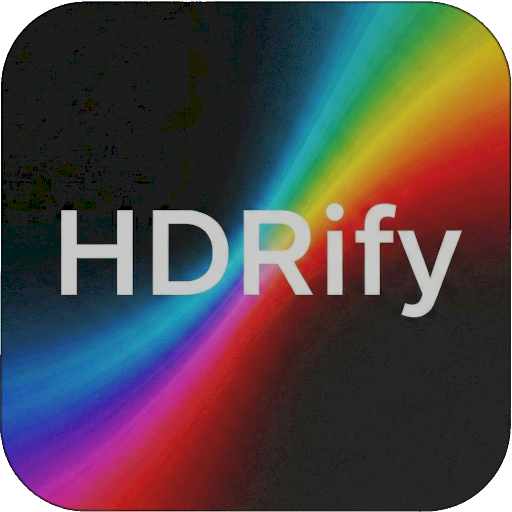

<p align="center">
  <a href="https://hdrify.ben3d.ca" target="_blank" rel="noopener noreferrer">
    
  </a>
</p>
<br/>
<p align="center">
  <a href="https://npmjs.com/package/hdrify-react"></a>
  <a href="https://www.npmtrends.com/hdrify-react"></a>
  <a href="https://codecov.io/gh/bhouston/hdrify"></a>
  <a href="https://discord.gg/5J5Ur3F6Z2"></a>
  <a href="https://hdrify.ben3d.ca"></a>
</p>
<br/>

# hdrify-react

> Display HDR images in React with configurable tone mapping.

- ⚛️ React Canvas Component
- 🎨 Four Tone Mappers
- ☀️ Adjustable Exposure
- 🖼️ Works With hdrify Readers
- 🔷 Typed Props

React component for displaying HDR images from [hdrify](https://www.npmjs.com/package/hdrify). Accepts `HdrifyImage` (returned by `readHdr`, `readExr`, `readJpegGainMap`) and renders with configurable tone mapping and exposure.

**Related packages:** [hdrify](https://www.npmjs.com/package/hdrify) (core library) · [hdrify-cli](https://www.npmjs.com/package/hdrify-cli) (CLI tool)

An **online demo** is available at **[https://hdrify.ben3d.ca](https://hdrify.ben3d.ca)** — HDR, EXR, and Ultra HDR viewer and converter built with this component; try it in your browser.

[Read the Docs to Learn More](https://hdrify.ben3d.ca/).

## Installation

```sh
pnpm add hdrify-react hdrify
```

## Usage

```tsx
import { HdrifyCanvas, type HdrifyImage } from 'hdrify-react';
import { readExr } from 'hdrify';

const hdrifyImage: HdrifyImage = readExr(buffer);

<HdrifyCanvas hdrifyImage={hdrifyImage} toneMapping="neutral" exposure={1.0} className="max-w-full" />;
```

### Props

| Prop           | Type                                         | Description                                           |
| -------------- | -------------------------------------------- | ----------------------------------------------------- |
| `hdrifyImage`  | `HdrifyImage`                                | Image from `readHdr`, `readExr`, or `readJpegGainMap` |
| `toneMapping`  | `'aces' \| 'reinhard' \| 'neutral' \| 'agx'` | Tone mapper to use                                    |
| `exposure`     | `number`                                     | Exposure value (1.0 = nominal)                        |
| `className`    | `string`                                     | Optional CSS class for the canvas                     |
| `forwardedRef` | `RefObject<HTMLCanvasElement \| null>`       | Optional ref for canvas access (e.g. `toBlob`)        |

## Contribution

See [Contributing Guide](https://github.com/bhouston/hdrify/blob/main/CONTRIBUTING.md).

## License

MIT

## Author

[Ben Houston](https://ben3d.ca), Sponsored by [Land of Assets](https://landofassets.com).
