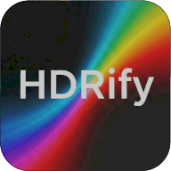
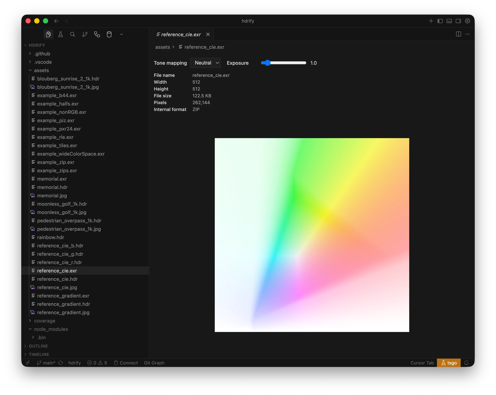

  

 

  
  
  
  
  

 

# HDRify VS Code Extension

> Preview and convert EXR, HDR, JPEG XL, and Ultra HDR images in VS Code.

- 👁️ Built-in HDR Image Preview
- 🎚️ Exposure and Tone Mapper Controls
- 🔄 Convert to EXR, HDR, JPEG XL, Ultra HDR
- 📂 Batch Convert Multiple Files
- 📦 No External Tools Required
- 🧩 Works in VS Code and Cursor

A VS Code and Cursor extension that adds HDR image conversion and preview for EXR, HDR, JPEG XL, and UltraHDR Jpeg files using the [hdrify](https://www.npmjs.com/package/hdrify) library. No external dependencies (OpenImageIO, OpenEXR, etc) required.

[Read the Docs to Learn More](https://hdrify.ben3d.ca/).

## Installation

- **VS Code**: Install from the [Visual Studio Code Marketplace](https://marketplace.visualstudio.com/items?itemName=benhouston3d.hdrify-vscode-extension).
- **Cursor**: Install from [Open VSX](https://open-vsx.org/extension/benhouston3d/hdrify-vscode-extension).

To install from a VSIX, run `pnpm run package` in `packages/hdrify-vscode-extension`, then use **Extensions: Install from VSIX...** and select the generated `.vsix` file.

## HDR Image Preview

- **EXR, HDR and JPEG XL**: Click any `.exr`, `.hdr` or `.jxl` file in the Explorer to open it with the HDR Image Preview (default action). The preview shows metadata (width, height, file size, pixels, internal format), an exposure slider (0.1–10), and a tonemapper selector (Neutral, AgX, ACES).
- **JPEG**: For UltraHDR Jpeg files, right-click and choose **Open with HDR Image Preview**. Standard JPEGs open with the built-in viewer by default; use "Reopen Editor With → HDR Image Preview" to try opening as HDR (will show an error if not a gain-map JPEG).

JPEG XL uses the shared React `ImageViewer` loader, also used by `<image-viewer>`. Both bare codestreams and containers are supported, with lossless or lossy pixels. Animated files show their first displayed frame; the status includes bit depth, encoding, color space and frame count.

## Convert HDR Image

Right-click an EXR, HDR, JPEG XL, or UltraHDR Jpeg in the Explorer. A **Convert HDR Image** submenu appears with:

- **Convert to EXR** — Output uses PIZ compression by default (configurable).
- **Convert to HDR** — Radiance RGBE format.
- **Convert to JPEG XL** — Lossless Modular encoding with 16-bit floating-point samples by default. Set `hdrify.jxlBitDepth` to `float32` to retain decoded source precision.
- **Convert to UltraHDR Jpeg** — JPEG with gain map (Ultra HDR / JPEG-R).

**Multi-select**: Select multiple files and right-click to convert all of them in one action. A progress indicator appears when processing two or more images.

## Supported Formats

| Format        | Extension       | Preview  | Convert |
| ------------- | --------------- | -------- | ------- |
| OpenEXR       | `.exr`          | Default  | ✓       |
| JPEG XL       | `.jxl`          | Default  | ✓       |
| Radiance HDR  | `.hdr`          | Default  | ✓       |
| UltraHDR Jpeg | `.jpg`, `.jpeg` | Optional | ✓       |

## Configuration

| Setting                                  | Type    | Default | Description                                                                                             |
| ---------------------------------------- | ------- | ------- | ------------------------------------------------------------------------------------------------------- |
| `hdrify.conversionQuality`               | number  | 90      | Quality for UltraHDR JPEG output (0–100)                                                                |
| `hdrify.leaveOriginalWhenChangingFormat` | boolean | false   | When converting, leave the original file and write to a new file (same name, target extension)          |
| `hdrify.exrCompression`                  | string  | `"piz"` | Compression for EXR output: `none`, `rle`, `zips`, `zip`, `piz`, `pxr24`, `b44`, `b44a`, `dwaa`, `dwab` |

JPEG XL is available in the same **Convert HDR Image** submenu as the other outputs. All four formats work as inputs, including batch selections. Float16 output rounds to half precision before lossless encoding; float32 retains decoded source precision. Animated JXL conversion uses the first displayed frame.

Additional setting: **`hdrify.jxlBitDepth`** (`float16` by default, or `float32`) controls JPEG XL sample precision.

## Replace vs Save-As Behavior

By default, the extension **replaces** the existing file when converting (overwrites with the new format and deletes the original). Enable **Leave original when changing format** to write to new files instead.

## Contribution

See [Contributing Guide](https://github.com/bhouston/hdrify/blob/main/CONTRIBUTING.md).

## License

MIT

## Author

[Ben Houston](https://ben3d.ca), Sponsored by [Land of Assets](https://landofassets.com).
