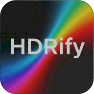

<p align="center">
  <a href="https://hdrify.ben3d.ca" target="_blank" rel="noopener noreferrer">
    
  </a>
</p>
<br/>
<p align="center">
  <a href="https://npmjs.com/package/hdrify"></a>
  <a href="https://www.npmtrends.com/hdrify"></a>
  <a href="https://codecov.io/gh/bhouston/hdrify"></a>
  <a href="https://discord.gg/5J5Ur3F6Z2"></a>
  <a href="https://hdrify.ben3d.ca"></a>
</p>
<br/>

# hdrify

> Read and write EXR, HDR, and Ultra HDR images in pure JavaScript.

- 📦 Pure JavaScript, No Native Bindings
- 🌐 Node.js, Browsers, and Web Workers
- 🗜️ All Major EXR Compressions
- 📸 Adobe and Ultra HDR Gain Maps
- 🎨 Four Built-in Tone Mappers
- 🔷 Full TypeScript Support

Universal EXR, HDR, and gain map image library for Node.js and browsers. Read and write HDR (Radiance RGBE), EXR (OpenEXR), and JPEG with gain maps (JPEG-R / Ultra HDR) in pure JavaScript. No native bindings.

**Related packages:** [hdrify-cli](https://www.npmjs.com/package/hdrify-cli) (CLI tool) · [hdrify-react](https://www.npmjs.com/package/hdrify-react) (React component)

[Read the Docs to Learn More](https://hdrify.ben3d.ca/).

## Capabilities

- Read and write RGB EXR files (none, RLE, ZIPS, ZIP, PIZ, PXR24, B44, B44A, DWAA and DWAB compression)
- Read and write HDR (Radiance RGBE) files
- Read and write both Adobe Gain Map JPEGs and Ultra HDR JPEGs (Android compatible)
- Tone mappers (ACES, Khronos Neutral, AgX, Reinhard)
- Resize with nearest, bilinear, or lanczos filters
- Flip horizontally and/or vertically
- Full TypeScript support
- No DOM or Node.js dependencies (works in browser, web workers, and Node.js)
- Written in a functional style to support tree-shaking

## Installation

```sh
pnpm add hdrify
```

## HdrifyImage

All read functions return `HdrifyImage`, and all write functions accept it. This is the universal intermediate format.

```ts
interface HdrifyImage {
  width: number;
  height: number;
  data: Float32Array; // RGBA: [R, G, B, A, R, G, B, A, ...]
  linearColorSpace: LinearColorSpace;
  metadata?: Record<string, unknown>;
}
```

## Usage

### Reading an EXR file

```ts
import { readExr } from 'hdrify';

const buffer = fs.readFileSync('image.exr');
const image = readExr(new Uint8Array(buffer));

console.log(`Image: ${image.width}x${image.height}`);
```

### Reading an HDR file

```ts
import { readHdr } from 'hdrify';

const buffer = fs.readFileSync('image.hdr');
const image = readHdr(new Uint8Array(buffer));
```

### Reading a JPEG gain map (JPEG-R / Ultra HDR)

```ts
import { readJpegGainMap } from 'hdrify';

const buffer = fs.readFileSync('image.jpg');
const image = readJpegGainMap(new Uint8Array(buffer));
// image.data is linear HDR Float32Array RGBA; metadata.format is 'ultrahdr' or 'adobe-gainmap'
```

### Converting between formats

```ts
import { encodeGainMap, readExr, writeExr, readHdr, writeHdr, writeJpegGainMap } from 'hdrify';

const image = readExr(new Uint8Array(fs.readFileSync('input.exr')));
fs.writeFileSync('output.hdr', writeHdr(image));

const encoding = encodeGainMap(image, { toneMapping: 'reinhard' });
fs.writeFileSync('output.jpg', writeJpegGainMap(encoding, { quality: 90 }));
```

### Resizing

```ts
import { readExr, resizeImage, writeExr } from 'hdrify';

const image = readExr(new Uint8Array(fs.readFileSync('input.exr')));
const resized = resizeImage(image, { width: 1024, height: 512, filter: 'lanczos' }); // filter: 'nearest' | 'bilinear' | 'lanczos' (default)
fs.writeFileSync('output.exr', writeExr(resized));
```

### Flipping

```ts
import { flipImage, readExr } from 'hdrify';

const image = readExr(new Uint8Array(fs.readFileSync('input.exr')));
const flipped = flipImage(image, { y: -1 }); // x/y: 1 (default, unchanged) or -1 (mirror that axis)
```

## Contribution

See [Contributing Guide](https://github.com/bhouston/hdrify/blob/main/CONTRIBUTING.md).

## License

MIT

## Author

[Ben Houston](https://ben3d.ca), Sponsored by [Land of Assets](https://landofassets.com).

## ICC metadata in JPEG gain maps

`readJpegGainMap` validates embedded ICC data with `hdrify-icc` and retains the
complete raw profile in `metadata.iccProfile`, including unknown tags and
multipart JPEG profiles. It does **not** apply the profile to pixels:
`metadata.iccColorManaged` is `false` when a profile is present. Pixel decoding
keeps the existing sRGB-base assumption and linear Rec.709 output. Applications
that need color management must apply it externally. Profiles using LUTs, CMYK,
or gray color spaces are retained as metadata without interpreting them.

`writeJpegGainMap` (both `ultrahdr` and `adobe-gainmap`) and
`writeGainMapAsSeparateFiles` accept `iccProfile: Uint8Array` containing raw ICC
bytes, splitting large profiles across JPEG APP2 segments. The legacy `icc`
option accepts a complete single APP2 payload with the `ICC_PROFILE` header and
chunk 1/1. Specify only one of these options; set either to `null` to omit ICC.
All three writer paths default to the existing sRGB profile. Separate-file
output embeds ICC in the SDR JPEG, not the gain-map JPEG.

Writers validate ICC structure but do not transform pixels or decide whether a
profile matches them. `encodeGainMap` produces an sRGB base; callers supplying
a different profile are responsible for matching that profile to the encoded
base samples. Raw profiles are embedded byte-for-byte without rewriting opaque
profile data or profile IDs.
